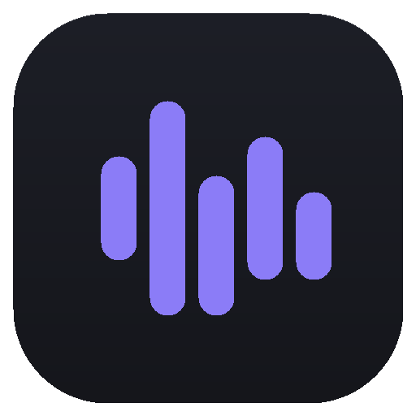

# EchoDeck

A premium desktop soundboard for Linux and Windows. Dark, fast, keyboard-friendly.



EchoDeck is a modern desktop soundboard built with Electron, React and TypeScript.
It plays multiple sounds simultaneously, supports system-wide global hotkeys, and
ships with a complete visual design system — deep graphite surfaces, a single
configurable accent color, subtle motion and strong typography.

Runs on **Linux** (AppImage/deb, virtual-mic output via PipeWire) and
**Windows** (portable zip, with optional virtual-mic output via VB-Cable).

## Features

- **Instant playback** — click a card (or its play button), multiple sounds at once
- **Global hotkeys** — trigger sounds and "Stop All" from anywhere in the system
- **Soundboards** — built-in Gaming / Memes / Discord / SCP plus unlimited custom boards
- **Waveforms** — real waveform peaks computed from the decoded audio, with live playback progress
- **Library tools** — favorites, recently played, most played, fuzzy search (`Ctrl+F`)
- **Command palette** (`Ctrl+K`) — play anything, jump anywhere
- **Drag & drop import** — MP3 · WAV · OGG · FLAC, from anywhere in the window
- **Sound editor** — slide-in panel with volume, loop, hotkey capture, soundboard assignment
- **Output device selection** and master volume in the top bar
- **Window state persistence**, settings, and library stored locally in `userData`
- **Demo sounds** seeded on first launch so you can play immediately

## Installing (end users)

### Windows

1. Extract `EchoDeck-<version>-x64.zip` and run `EchoDeck.exe` — portable, no installer, no admin rights. SmartScreen may ask for confirmation since the app is unsigned: *More info → Run anyway*. Requires Windows 10/11 64-bit.

### Linux

```bash
chmod +x EchoDeck-<version>.AppImage
./EchoDeck-<version>.AppImage
```

Requires a modern 64-bit distro with PipeWire or PulseAudio. If it doesn't start on an older distro, install `libfuse2`, or run it extracted: `./EchoDeck-<version>.AppImage --appimage-extract && ./squashfs-root/AppRun`.

### First launch

The app opens with five demo sounds — click one or press `F1`–`F3`. Import your own sounds by dropping files anywhere in the window, then assign hotkeys from a sound card's `⋮` menu or the editor panel.

#### Virtual microphone (play sounds into voice chat)

- **Linux** — enable **Settings → Audio → Play into virtual microphone**, then select *"Monitor of EchoDeck Virtual Mic"* as the input in your game or Discord. No extra setup.
- **Windows** — one-time driver install: **Settings → Audio → Install VB-Cable** (downloads the official free driver and launches it), then enable *Play into virtual microphone* + *Include my real microphone*, and select **"CABLE Output (VB-Audio Virtual Cable)"** as the game/Discord input.

Your voice always passes through; sounds are mixed in only while they play.

## Development

```bash
npm install
npm run dev
```

The app opens with five synthesized demo sounds (Laser, Riser, Kick, Siren, Chime)
spread across the built-in soundboards.

## Scripts

| Command | Description |
| --- | --- |
| `npm run dev` | Start with HMR (renderer hot reload) |
| `npm run build` | Production build to `out/` |
| `npm run typecheck` | Strict TypeScript check |
| `npm run dist` | Package AppImage + deb via electron-builder |
| `node scripts/smoke.mjs` | Headless UI smoke test (jsdom) |

## Distributing on itch.io

See [ITCH.md](ITCH.md): build the AppImage, push with `butler`, and set up the
page (a ready-made 630×500 cover is generated at `resources/cover.png`).

## Keyboard

| Shortcut | Action |
| --- | --- |
| `Ctrl+K` | Command palette |
| `Ctrl+F` | Search sounds |
| `Arrows` / `Enter` / `Space` | Navigate the grid and play cards |
| `Escape` | Close panels, menus and dialogs |
| `F1`–`F3` (default) | Demo sound hotkeys — reassign anything |

## Wayland & global hotkeys

Native Wayland sessions have no X11 key grabs, so EchoDeck uses the
**xdg-desktop-portal GlobalShortcuts** interface (Electron 34's
`GlobalShortcutsPortal`). The first time a hotkey is registered, your desktop
may show a confirmation dialog — approve it, or manage entries later under
System Settings → Global Shortcuts → EchoDeck. If the portal is unavailable,
assigned keys still work while the EchoDeck window is focused.

## Design system

All visual decisions are centralized in CSS custom properties:

- `src/renderer/src/styles/tokens.css` — surfaces, borders, text, accent, radii, motion
- `src/renderer/src/styles/base.css` — reset, controls, tooltips, keycaps
- `src/renderer/src/styles/layout.css` — app shell (top bar / sidebar / main / status bar)
- `src/renderer/src/styles/components.css` — modals, menus, toasts, popovers
- `src/renderer/src/styles/views.css` — sound cards, editor, settings, palette, playback bar

Six accent presets (violet, electric blue, cyan, mint, amber, rose) live in
`src/renderer/src/lib/accents.ts` and are applied as CSS variables at runtime.

## Project structure

```
src/
  main/       Electron main process (window, protocol, hotkeys, storage)
  preload/    Context bridge API
  renderer/
    index.html
    src/
      components/   UI components
      store/        zustand stores (library + player)
      lib/          audio engine, fuzzy search, peaks, hotkeys, accents
      styles/       design tokens + stylesheets
resources/
  demo/       Seeded demo WAVs (generated by scripts/generate_assets.py)
  icon.png    App icon
```

## Audio storage

Imported files are copied into `~/.config/echodeck/sounds` and served to the
renderer through a private `sound://` protocol. The library (sounds, hotkeys,
settings) is persisted to `library.json` next to it.

## License

MIT
